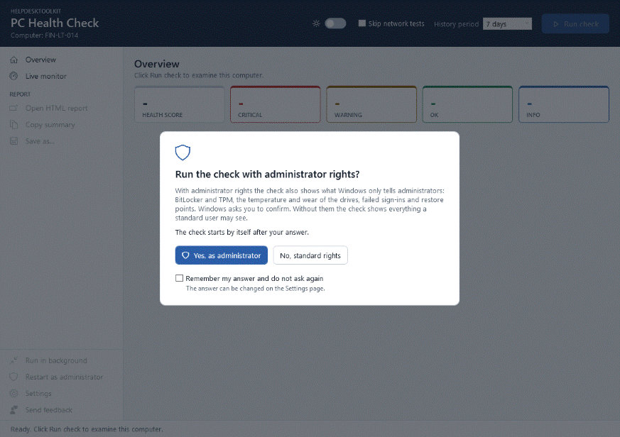
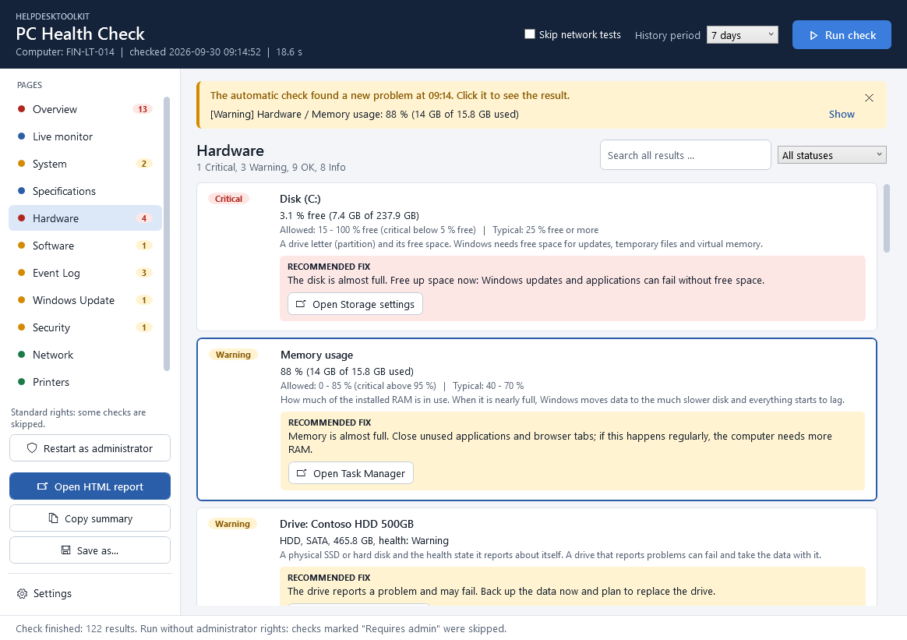
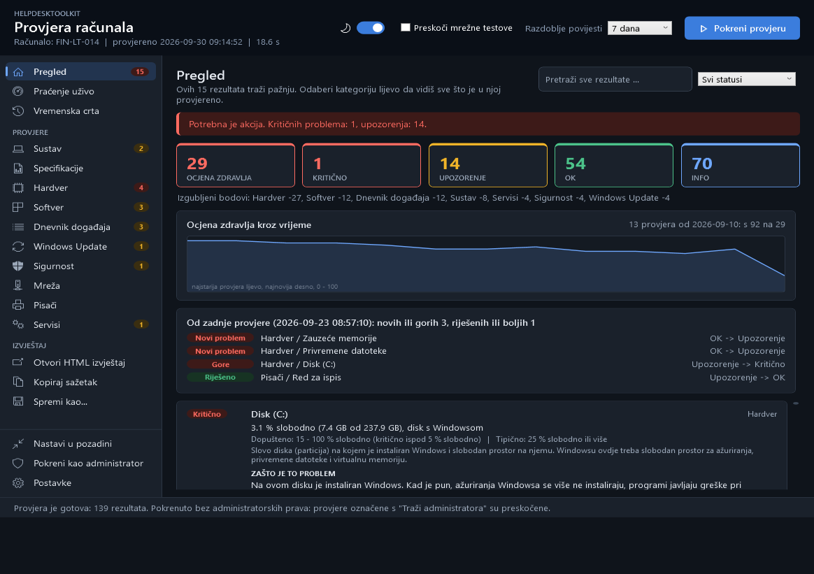
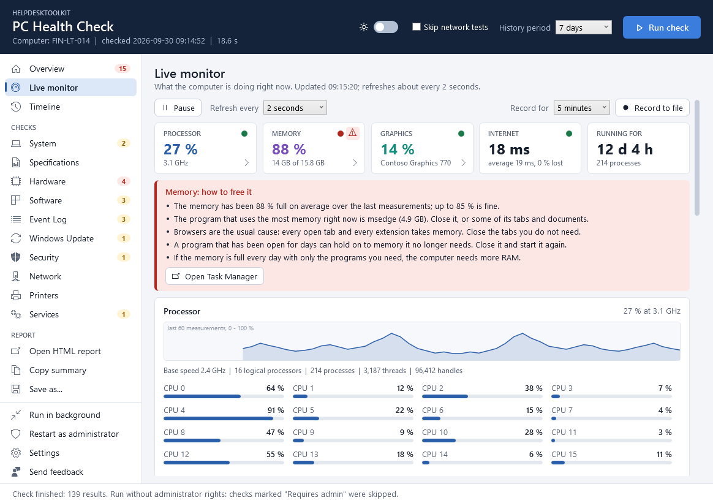
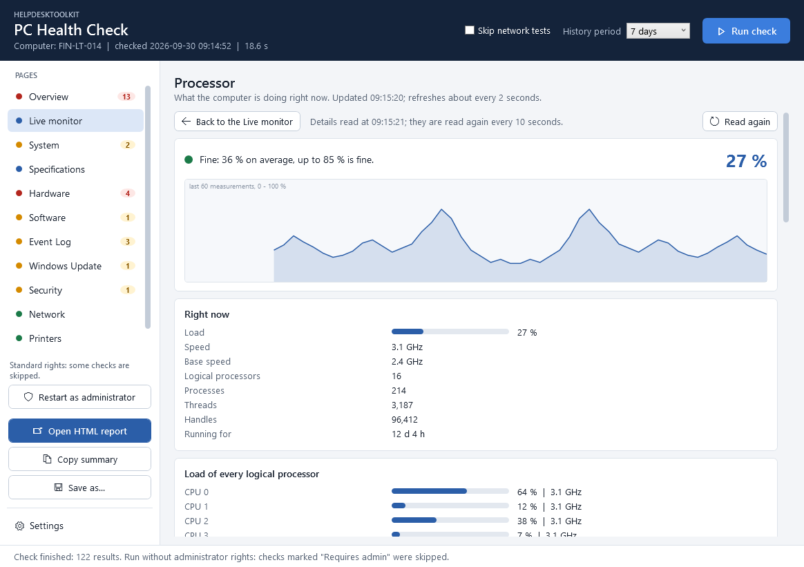
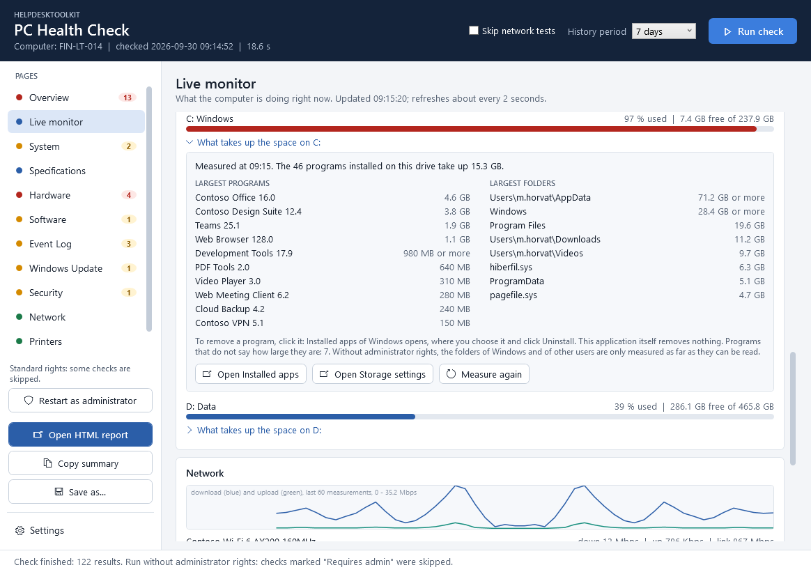
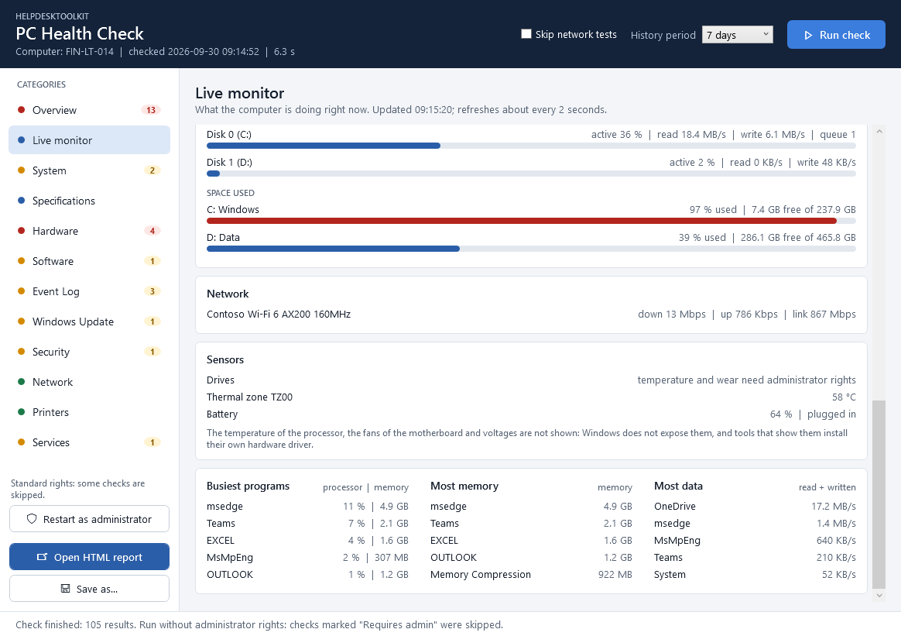

# HelpdeskToolkit

[](https://github.com/Majstor767/HelpdeskToolkit/actions/workflows/ci.yml)
[](LICENSE)


*English version: [README.md](README.md)*

Dijagnostički alat za Windows računala, namijenjen radu u helpdesku i IT podršci. Jednim
klikom ili jednom naredbom provjeri stanje računala i napravi pregledan izvještaj s
pronađenim problemima i preporukama što učiniti.

- **Samo čita.** Alat samo čita podatke i nikad ništa ne mijenja na sustavu.
- **Ne traži administratorska prava.** Provjere kojima trebaju preskače i označava s "Requires admin".
- **Ne traži ništa osim samog alata.** Napisan je u PowerShellu i koristi ono što Windows već ima.

Prozor se može prebaciti na hrvatski (stranica **Settings**). Izvještaji i naredbe su na
engleskom, pa su i nazivi u ovom dokumentu navedeni onako kako pišu na engleskom.



## Što provjerava

| Kategorija | Provjere |
|---|---|
| System | Ime računala, verzija i build Windowsa, ima li ta verzija još Microsoftovu podršku, datum instalacije, proizvođač i model, domena ili radna grupa, prijavljeni korisnik, vremenska zona, uptime, indeks stabilnosti, aktivacija Windowsa, programi koji se pokreću sa sustavom, zakazani zadaci koji nisu dio Windowsa, plan napajanja, Fast Startup, trajanje zadnjeg pokretanja\*, veličina korisničkih profila\* |
| Specifications | Procesor s veličinom cache memorije i stanjem virtualizacije, raspored memorije i slobodni utori, svaki memorijski modul (utor, brzina, proizvođač, kataloški broj), grafičke kartice s memorijom i datumom drivera, monitori, fizički diskovi s verzijom firmwarea, optički pogoni, audio uređaji, tipkovnice i pokazivački uređaji, matična ploča, BIOS/UEFI, serijski broj |
| Hardware | Opterećenje CPU-a, zauzeće RAM-a i najveći potrošači memorije, zdravlje svakog fizičkog diska, slobodan prostor po disku, najveće mape na disku koji se puni, prostor koji se može osloboditi (privremene datoteke, Downloads, koš za smeće), datoteka hibernacije, page file, uređaji bez ispravnog drivera, nepotpisani driveri, stari driveri, napunjenost i zdravlje baterije (preostali kapacitet u odnosu na novu bateriju), detalji diska (temperatura, istrošenost, sati rada, neispravljene greške)\*, diskovi označeni za provjeru\*, privremene datoteke Windowsa\* |
| Software | Instalirani programi s verzijama, nedavno instalirani programi, rušenja aplikacija po programu, proširenja preglednika, zadani preglednik |
| Event Log | Neočekivana gašenja, plavi ekrani, greške diska, greške hardvera (WHEA), kritični događaji i greške u System i Application logu u zadnjih N dana, najčešći izvori |
| Windows Update | Zadnje instalirano ažuriranje, ažuriranja koja čekaju instalaciju, ažuriranja koja se nisu uspjela instalirati, čeka li se restart, jesu li ažuriranja pauzirana |
| Security | Zaštita u stvarnom vremenu, starost definicija, zaštita od neovlaštenih izmjena, zadnje skeniranje i povijest prijetnji Microsoft Defendera, firewall profili, User Account Control, Remote Desktop, vrsta računa, članovi grupe Administrators, automatska prijava, lokalni računi i račun Guest, dijeljene mape, portovi otvoreni prema mreži i programi koji na njima slušaju, sigurnosne kopije (File History, OneDrive, System Restore), Secure Boot, TPM\*, BitLocker na svakom disku\*, neuspjele prijave\*, zaključani računi\*, točke vraćanja\* |
| Network | Adapteri (IPv4, gateway, DNS, DHCP, MAC, brzina veze), jačina signala, pojas, standard i zaštita Wi-Fi mreže, mrežni profil, proxy, hosts datoteka, mapirani mrežni diskovi, ping gatewaya i interneta, DNS razlučivanje, HTTPS pristup, točnost sata |
| Printers | Zadani pisač, instalirani pisači i oni koji su offline, dokumenti zaglavljeni u redu za ispis |
| Services | DHCP Client, DNS Client, Windows Event Log, Workstation, Windows Defender Firewall, Microsoft Defender Antivirus, Windows Update, BITS, Print Spooler te servisi koji nisu dio Windowsa |

\* traži administratorska prava; inače je označeno s "Requires admin". Vidi [Administratorska prava](#administratorska-prava).

Svaki rezultat ima status (**OK**, **Warning**, **Critical** ili **Info**), kratko
objašnjenje što je to što se provjerava i preporučeno rješenje kad god je status Warning
ili Critical. Uz mjerenja se prikazuju i dopušteni raspon te tipična vrijednost za
usporedbu.

## Prozor


Klikni **Run check**; traka napretka pokazuje koja se kategorija upravo provjerava.
Nakon te prve provjere aplikacija sama održava rezultate ažurnima.

- **Overview** prikazuje sve probleme s preporučenim rješenjem. Uz rješenje stoji gumb
  koji otvara mjesto u Windowsu gdje se ono provodi (**Open Storage settings**,
  **Open Task Manager**, **Open Windows Update**, ...). Gumb samo otvara tu stranicu;
  samu promjenu uvijek radi osoba za računalom.
- **Health score** od 0 do 100 sažima provjeru u jedan broj: svaki rezultat Critical
  oduzima 15 bodova, a svaki Warning 4.
- **Since the last check** pokazuje što je novo, gore, bolje ili riješeno u odnosu na
  prethodnu provjeru istog računala. Aplikacija za to čuva zadnjih 30 izvještaja.
- **Kategorije** lijevo (System, Hardware, Network, ...) prikazuju sve što je
  provjereno; točka i broj uz svaku pokazuju gdje su problemi.
- **Najteže prvo:** na svakoj stranici, i u izvještaju, rezultati su poredani kao
  Critical, Warning, OK, Info, pa problem nikad nije skriven negdje niže.
- **Pretraga** traži po svim rezultatima odjednom, a filtar statusa sužava popis, na
  primjer samo na probleme.
- **Copy summary** stavlja kratak tekstualni sažetak u međuspremnik, spreman za
  lijepljenje u ticket ili e-mail.
- **Open HTML report** sprema izvještaj i otvara ga u pregledniku, a **Save as...** ga
  sprema kao HTML, PDF, CSV ili JSON na mjesto koje odabereš.

### Automatska provjera i obavijesti

Provjera se ponavlja u pozadini svakih pet minuta (razmak se u postavkama može
promijeniti ili isključiti). Novi rezultati zamjenjuju stare bez prekidanja: otvorena
stranica, pretraga i mjesto do kojeg si listao ostaju kakvi jesu.

Problem kojeg prije nije bilo najavljuje se u traci na vrhu prozora, a dok prozor nije
u prvom planu i Windows obavijesti. Klik vodi ravno na rezultat, koji je uokviren da ga
je lako naći. Obavijest nestaje kad je zatvoriš ili kad problema više nema.



Tipkovni prečaci:

| Tipka | Radnja |
|---|---|
| `F5` | Pokreni provjeru |
| `Ctrl+F` | Pretraga; `Esc` je briše |
| `Ctrl+O` | Otvori HTML izvještaj |
| `Ctrl+S` | Save as... |
| `Ctrl+Shift+C` | Kopiraj sažetak |
| `Ctrl+M` | Live monitor |
| `Ctrl+,` | Settings |

### Jezik i tema

Na stranici **Settings**, koja se otvara gumbom sa zupčanikom ispod popisa stranica,
prozor se prebacuje između engleskog i hrvatskog te između svijetle i tamne teme (ili
one koju koristi Windows). Izvještaji i naredbe ostaju na
engleskom, pa izvještaj izgleda jednako tko god ga napravio. Aplikacija pamti i
veličinu i položaj prozora.



Postavke i povijest izvještaja čuvaju se u `%LOCALAPPDATA%\HelpdeskToolkit`; na stranici
Settings postoji gumb koji otvara tu mapu. Brisanjem mape aplikacija se vraća na
početno stanje.

## Live monitor

Stranica **Live monitor** u prozoru ne traži provjeru. Prikazuje što računalo radi u
ovom trenutku:

- **Statusne točkice:** pločice procesora, memorije i grafike imaju točkicu. Zelena je
  dok je vrijednost u redu, narančasta kad se približi granici ili stalno raste prema
  njoj, a crvena kad je iznad granice. Uz crvenu točkicu pojavi se trokut upozorenja;
  klik na njega otvara savjete kako vrijednost smanjiti, s imenom programa koji u tom
  trenutku najviše opterećuje.
- **Sve o komponenti:** klik na pločicu Processor, Memory ili Graphics otvara stranicu
  koja ispuni prozor svime što se o toj komponenti može pročitati. Za procesor su to,
  među ostalim, predmemorije, mogućnosti, na što mu odlazi vrijeme i opterećenje svakog
  logičkog procesora; za memoriju svaki modul s kataloškim brojem, utori i page file;
  za grafičku karticu driver, taktovi, programi koji je koriste i spojeni monitori.
  Stranica završava svakim svojstvom koje Windows javlja, pod nazivom koji mu Windows
  daje. `Esc` vraća natrag.
- **Procesor:** ukupno opterećenje s grafom povijesti, takt na kojem stvarno radi
  (uključujući turbo), opterećenje svakog logičkog procesora, broj procesa, niti i
  handleova, vrijeme od pokretanja Windowsa
- **Memorija:** zauzeće s grafom povijesti, dostupna, predmemorirana (cached) i
  rezervirana (committed) memorija, kernel poolovi, zauzeće page filea
- **Grafika:** opterećenje s grafom povijesti, opterećenje po engineu (3D, copy, video
  decode, video encode), vlastita i dijeljena memorija
- **Diskovi:** aktivnost s grafom povijesti, brzina čitanja i pisanja te red čekanja
  svakog fizičkog diska, i zauzeti prostor svakog slova diska (mjerač postaje narančast
  i crven prema istim pragovima kao provjera prostora na disku)
- **Što zauzima prostor:** svako slovo diska može se otvoriti da se vide njegovi najveći
  instalirani programi i mape. Klik na program otvara Windowsovu stranicu *Installed
  apps*, na kojoj se deinstalira, i kopira njegov naziv za polje pretrage na toj
  stranici; gumb otvara stranicu na kojoj se čiste datoteke
- **Mreža:** brzina preuzimanja i slanja s grafom povijesti te brzina veze svakog adaptera
- **Senzori:** temperatura, brzina ventilatora i potrošnja NVIDIA grafičkih kartica;
  termalne zone i baterija na računalima koja ih imaju; temperatura, istrošenost i sati
  rada diskova\*
- **Programi:** oni koji troše najviše procesorskog vremena, najviše memorije te čitaju i
  pišu najviše podataka. Klikom na program vidi se odakle je pokrenut, tko ga je
  napravio, otkad radi i koliko procesa ima.

\* traži administratorska prava.

Alati na vrhu stranice:

- **Pause** zamrzava prikaz, a osvježavanje se može postaviti na 2, 5, 10 ili 30 sekundi.
- **Record to file** zapisuje svako mjerenje u CSV datoteku u `Documents\HelpdeskToolkit`
  tijekom 1, 5, 15 ili 60 minuta. To je odgovor na "ponekad je sporo": snimaj dok
  korisnik radi, pa datoteku pogledaj u programu za tablice.
- **Upozorenja** se pojave kad procesor, memorija ili disk ostanu iznad 90 % nekoliko
  mjerenja zaredom, ili kad se grafička kartica zagrije iznad 85 °C. Jedan kratki skok
  je normalan i ne izaziva upozorenje.

Gumba koji gasi ili deinstalira program namjerno nema: alat samo čita. Pokaže što
ukloniti i otvori mjesto u Windowsu gdje se to radi.









Isti podaci dostupni su u skriptama kroz `Get-PerformanceSnapshot`.

Odakle dolaze vrijednosti senzora i što namjerno nedostaje:

- Vrijednosti NVIDIA grafičkih kartica čitaju se alatom `nvidia-smi`, koji instalira sam
  NVIDIA driver. Pokreće se iz Windowsove mape `System32` punom putanjom. Kartice drugih
  proizvođača nemaju usporediv alat, pa se za njih prikazuju samo opterećenje i memorija.
- Temperatura procesora, ventilatori matične ploče i naponi se ne prikazuju. Windows ih
  ne daje programima; alati koji ih prikazuju instaliraju vlastiti hardverski driver, što
  ovaj alat namjerno ne radi.

## Administratorska prava

Alat radi bez administratorskih prava. Dio podataka Windows prikazuje samo
administratorima; te se provjere tada preskaču i označavaju s "Requires admin".

Da ih uključiš, u prozoru klikni **Restart as administrator** ili pokreni PowerShell s
"Pokreni kao administrator" prije korištenja naredbi. Windows traži potvrdu (User
Account Control); alat sam sebi ne može dati ta prava. I s administratorskim pravima
alat samo čita.

Ako se potvrda da računom druge osobe (npr. IT administrator na računalu običnog
korisnika), provjere koje opisuju korisnika (programi pri pokretanju, proxy, mapirani
diskovi, privremene datoteke) opisuju taj račun.

## Izvještaj

HTML izvještaj je jedna samostalna datoteka (bez skripti, ništa se ne učitava s
interneta), pa se može poslati e-mailom ili priložiti uz ticket. Prati svijetlu ili
tamnu temu sustava i ima izgled prilagođen ispisu.


Cijeli primjer s izmišljenim podacima nalazi se u [docs/sample-report.html](docs/sample-report.html)
(preuzmi ga i otvori u pregledniku). Isti podaci u JSON-u:
[docs/sample-report.json](docs/sample-report.json).

Ostali formati:

| Format | Čemu služi |
|---|---|
| JSON | Daljnja obrada i usporedba dviju provjera naredbom `Compare-PCHealthReport` |
| CSV | Program za tablice; jedan redak po rezultatu |
| PDF | Arhiviranje i ispis. To je HTML izvještaj ispisan u datoteku, za što na računalu treba Microsoft Edge ili Google Chrome. |

## Instalacija

### Instalacijski program (preporučeno)

1. Preuzmi `HelpdeskToolkit-Setup-<verzija>.exe` sa stranice [Releases](https://github.com/Majstor767/HelpdeskToolkit/releases).
2. Pokreni ga. Instalira se samo za trenutnog korisnika i ne traži administratorska prava.
3. Pokreni **HelpdeskToolkit** iz Start izbornika.

Instalacijski program nije digitalno potpisan, pa Windows SmartScreen pri prvom
pokretanju prikaže "Windows protected your PC". Odaberi **More info** pa **Run anyway**.
Preuzetu datoteku možeš provjeriti prema `SHA256SUMS.txt` iz istog izdanja:

```powershell
Get-FileHash .\HelpdeskToolkit-Setup-<verzija>.exe -Algorithm SHA256
```

Uklanja se kroz **Postavke > Aplikacije > Instalirane aplikacije**.

### Prijenosni ZIP

1. Preuzmi `HelpdeskToolkit-<verzija>.zip` sa stranice [Releases](https://github.com/Majstor767/HelpdeskToolkit/releases).
2. Desni klik na ZIP, **Svojstva**, označi **Deblokiraj**, pa ga raspakiraj.
3. Dvoklik na `Start-HelpdeskToolkit.cmd`.

### Kao PowerShell modul

```powershell
git clone https://github.com/Majstor767/HelpdeskToolkit.git
cd HelpdeskToolkit
Import-Module .\HelpdeskToolkit\HelpdeskToolkit.psd1
```

Ako PowerShell odbije učitati modul jer je pokretanje skripti onemogućeno, dopusti
lokalne skripte za svoj korisnički račun:

```powershell
Set-ExecutionPolicy -Scope CurrentUser -ExecutionPolicy RemoteSigned
```

## Korištenje iz naredbenog retka

`Show-PCHealthCheck` otvara gore opisani prozor. Sve ostalo radi i bez njega.

```powershell
# Pokreni sve provjere, spremi HTML izvještaj u Documents\HelpdeskToolkit i otvori ga
Invoke-PCHealthCheck

# 30 dana Event Loga, HTML i JSON, spremljeno u mapu po izboru
Invoke-PCHealthCheck -OutputPath C:\Temp\Reports -Days 30 -Format Both

# Bez preglednika i bez mrežnih testova; vrati samo ono što traži pažnju
Invoke-PCHealthCheck -NoOpen -SkipNetwork -PassThru |
    Where-Object Status -in 'Warning', 'Critical'
```

| Parametar | Značenje |
|---|---|
| `-OutputPath` | Mapa za izvještaj. Zadano: `Documents\HelpdeskToolkit`. |
| `-Days` | Koliko dana Event Loga i rušenja aplikacija se analizira. Zadano: 7. |
| `-Format` | `Html` (zadano), `Json`, `Csv`, `Pdf`, `Both` (HTML i JSON) ili `All`. |
| `-SkipNetwork` | Preskače ping, DNS i HTTPS testove. Konfiguracija adaptera se i dalje ispisuje. |
| `-ComputerName` | Provjerava drugo računalo, vidi [Drugo računalo](#drugo-računalo). |
| `-Credential` | Račun koji se koristi na drugom računalu. |
| `-NoOpen` | Ne otvara HTML izvještaj u pregledniku. |
| `-PassThru` | Dodatno vraća rezultate kao objekte. |

### U skriptama

Svaka kategorija je zasebna naredba, a `Get-PCHealthReport` vraća sve kao jedan objekt,
bez ispisa i spremanja:

```powershell
Get-HardwareHealth | Where-Object Check -like 'Disk*'
Get-NetworkHealth -SkipConnectivity
Get-ComputerSpecification | Format-Table Check, Value -AutoSize

$report = Get-PCHealthReport -Days 14
$report.Score
$report.Summary
$report.Results | Where-Object Status -eq 'Critical'

# Što računalo radi upravo sada: opterećenje po logičkom procesoru, najzaposleniji programi
$now = Get-PerformanceSnapshot
$now.Cpu.Processors | Format-Table Name, Percent, FrequencyMHz
$now.Processes
```

Dostupne naredbe: `Invoke-PCHealthCheck`, `Show-PCHealthCheck`, `Get-PCHealthReport`,
`Compare-PCHealthReport`, `Get-SystemHealth`, `Get-ComputerSpecification`,
`Get-HardwareHealth`, `Get-SoftwareHealth`, `Get-EventLogHealth`,
`Get-WindowsUpdateHealth`, `Get-SecurityHealth`, `Get-NetworkHealth`,
`Get-PrinterHealth`, `Get-ServiceHealth`, `Get-PerformanceSnapshot`. Svaka ima potpunu
pomoć: `Get-Help <naredba> -Full`.

Svaki rezultat provjere je objekt s istim svojstvima:

| Svojstvo | Sadržaj |
|---|---|
| `Category`, `Check` | Što je provjereno |
| `Description` | Što je to što se provjerava i čemu služi |
| `Status` | `OK`, `Warning`, `Critical` ili `Info` |
| `Value` | Što je pronađeno |
| `Details` | Ostatak dugog popisa (npr. svi programi koji se pokreću sa sustavom) |
| `Allowed`, `Typical` | Za mjerenja: raspon koji se smatra ispravnim i uobičajena vrijednost |
| `Recommendation` | Što učiniti kad status nije OK |

### Usporedba dviju provjera

Je li popravak pomogao? Spremi JSON izvještaj prije i poslije pa ih usporedi:

```powershell
Compare-PCHealthReport -Reference .\before.json -Difference .\after.json |
    Format-Table Change, Category, Check, Before, After
```

Svaki redak kaže je li problem nov, gori, bolji ili riješen. Rezultati koji se nisu
promijenili se ne ispisuju.

### Automatizacija: izlazni kodovi

`Invoke-HealthCheck.ps1` u glavnoj mapi pokreće provjeru i rezultat javlja izlaznim
kodom, a to je ono što gledaju sustavi za nadzor, alati za distribuciju i zakazani
zadaci:

| Izlazni kod | Značenje |
|---|---|
| 0 | Nema problema (svi rezultati su OK ili Info) |
| 1 | Barem jedan Warning, nijedan Critical |
| 2 | Barem jedan Critical |
| 3 | Sama provjera se nije mogla izvršiti |

```powershell
powershell.exe -NoProfile -ExecutionPolicy Bypass -File .\Invoke-HealthCheck.ps1 -Format Json -Quiet
```

### Drugo računalo

```powershell
Invoke-PCHealthCheck -ComputerName PC-014 -Credential (Get-Credential)
```

Provjera se tada izvršava na drugom računalu kroz PowerShell remoting, a izvještaj
nastaje na tvom. Na drugom računalu ne treba ništa instalirati i ništa ondje ne ostaje:
modul se pošalje i učita samo u memoriju. Uvjeti su uobičajeni za PowerShell remoting:
mora biti uključen na drugom računalu (u domeni se to inače radi kroz Group Policy), a
račun ondje mora biti administrator.

Ovaj dio je eksperimentalan. Pokriven je automatskim testovima i isproban tako da je
modul na isti način učitan u čistu sesiju na jednom računalu, ali još nije isproban
preko stvarne veze između dva računala.

## Konfiguracija

Ponašanje određuju tri podatkovne datoteke; kod se ne mora mijenjati:

- [`HelpdeskToolkit/Config/Thresholds.psd1`](HelpdeskToolkit/Config/Thresholds.psd1):
  pragovi za Warning i Critical (npr. slobodan prostor na disku ispod 15 % i 5 %),
  odredišta mrežnih testova, popis praćenih servisa, pragovi upozorenja i statusnih
  točkica u Live monitoru, bodovi za Health score i datumi kraja podrške za verzije Windowsa (preuzeti
  s Microsoftovih stranica o životnom ciklusu; kad izađe nova verzija, dodaje se jedan
  redak).
- [`HelpdeskToolkit/Config/Descriptions.psd1`](HelpdeskToolkit/Config/Descriptions.psd1):
  objašnjenje koje se prikazuje uz svaku provjeru.
- [`HelpdeskToolkit/Config/Actions.psd1`](HelpdeskToolkit/Config/Actions.psd1):
  koju stranicu Windowsa otvara gumb uz preporučeno rješenje.

Vrijednosti "Typical" su iskustvene, okvirne vrijednosti za zdravo uredsko računalo.
Služe samo za usporedbu i nikad ne utječu na status.

Prijevod prozora je još jedna podatkovna datoteka:
[`HelpdeskToolkit/Lang/hr.psd1`](HelpdeskToolkit/Lang/hr.psd1) sadrži hrvatske tekstove
uz engleske izvornike. Tekst bez prijevoda jednostavno se prikaže na engleskom.

## Zahtjevi

- Windows 10 verzije 1809 ili noviji, ili Windows 11
- Windows PowerShell 5.1 (dio Windowsa) ili PowerShell 7

## Razvoj

```text
HelpdeskToolkit/          modul
  Public/                 izvezene naredbe, jedna po datoteci
  Private/                interne pomoćne funkcije, jedna po datoteci
  Config/                 pragovi, opisi i odredišta gumba uz rješenja
  Lang/                   prijevodi prozora
  Assets/                 stilovi izvještaja, izgled prozora (XAML), tamna tema, ikona
tests/                    Pester testovi
tools/                    skripte za testiranje, slaganje izdanja i generiranje datoteka
installer/                Inno Setup skripta
docs/                     primjer izvještaja, slike, bilješke o objavi
.github/workflows/        CI i automatsko izdavanje
Invoke-HealthCheck.ps1    provjera s izlaznim kodom, za automatizaciju
Start-HelpdeskToolkit.*   pokreće prozor
```

Promjene po verzijama popisane su u [CHANGELOG.md](CHANGELOG.md).

### Testovi

Testovi koriste [Pester](https://pester.dev) 5 ili noviji s mockovima, pa rezultat ne
ovisi o računalu na kojem se izvršavaju. Stil koda provjerava
[PSScriptAnalyzer](https://github.com/PowerShell/PSScriptAnalyzer).

```powershell
Install-Module Pester -MinimumVersion 5.5.0 -Scope CurrentUser -Force -SkipPublisherCheck
Install-Module PSScriptAnalyzer -Scope CurrentUser -Force

.\tools\Test-Project.ps1            # PSScriptAnalyzer i svi testovi
.\tools\Test-Project.ps1 -Coverage  # dodatno ispisuje pokrivenost koda
```

Windows PowerShell 5.1 i PowerShell 7 drže module u različitim mapama, pa ta dva modula
treba instalirati u svakoj verziji kojom želiš testirati.

GitHub Actions pokreće istu skriptu na Windows PowerShellu 5.1 i PowerShellu 7 na svaki push.

### Slaganje izdanja

```powershell
.\tools\Build-Release.ps1           # instalacija (treba Inno Setup 6), ZIP i kontrolni zbrojevi u dist\
.\tools\Build-Release.ps1 -SkipInstaller
```

Slanje oznake poput `v1.0.0` pokreće testove, slaže instalaciju i ZIP te ih objavljuje
kao GitHub izdanje. Oznaka se mora podudarati s `ModuleVersion` u manifestu. Koraci za
izdanje, PowerShell Gallery i winget zapisani su u [docs/publishing.md](docs/publishing.md).

### Generirane datoteke

```powershell
.\tools\New-SampleReport.ps1        # docs\sample-report.html i .json (izmišljeni podaci)
.\tools\New-Screenshot.ps1          # docs\screenshot-*.png i docs\demo.gif
.\tools\New-AppIcon.ps1             # ikona aplikacije
```

## Licenca

[MIT](LICENSE)
