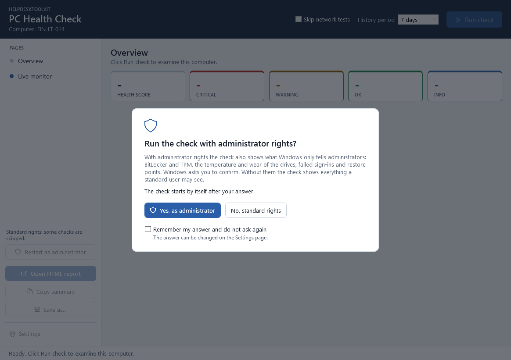

# HelpdeskToolkit

[](https://github.com/Majstor767/HelpdeskToolkit/actions/workflows/ci.yml)
[](LICENSE)


*Hrvatska verzija: [README.hr.md](README.hr.md)*

A diagnostic tool for Windows PCs, built for helpdesk and IT support work. One click or
one command checks the state of the computer and produces a clear report with the
problems it found and what to do about them.

- **Read-only.** It only reads information and never changes anything on the system.
- **No administrator rights needed.** Checks that need them are skipped and marked "Requires admin".
- **Nothing to install besides the tool.** It is written in PowerShell and uses what Windows already has.


## What it checks

| Category | Checks |
|---|---|
| System | Computer name, Windows version and build, whether that version is still supported by Microsoft, install date, manufacturer and model, domain or workgroup, signed-in user, time zone, uptime, stability index, Windows activation, startup programs, scheduled tasks that are not part of Windows, power plan, Fast Startup, last startup duration\*, size of the user profiles\* |
| Specifications | Processor with cache sizes and virtualization state, memory layout and free slots, every memory module (slot, speed, manufacturer, part number), graphics adapters with memory and driver date, displays, physical drives with firmware version, optical drives, audio devices, keyboards and pointing devices, motherboard, BIOS/UEFI, serial number |
| Hardware | CPU load, memory usage and the top memory consumers, health of every physical drive, free space per disk, the largest folders of a disk that is running full, space that can be freed (temporary files, Downloads, Recycle Bin), hibernation file, page file, devices without a working driver, unsigned drivers, old drivers, battery charge and battery health (capacity left compared to a new battery), drive details (temperature, wear, power-on hours, uncorrected errors)\*, drives flagged for a disk check\*, temporary files of Windows\* |
| Software | Installed programs with versions, recently installed programs, application crashes per program, browser extensions, default browser |
| Event Log | Unexpected shutdowns, blue screens, disk errors, hardware errors (WHEA), critical events and errors in the System and Application logs for the last N days, top sources |
| Windows Update | Last installed update, updates waiting to be installed, updates that failed to install, pending restart, paused updates |
| Security | Microsoft Defender real-time protection, definition age, tamper protection, last scan and threat history, firewall profiles, User Account Control, Remote Desktop, account type, members of the Administrators group, automatic sign-in, local accounts and the Guest account, shared folders, ports open to the network and the programs behind them, backup (File History, OneDrive, System Restore), Secure Boot, TPM\*, BitLocker on every drive\*, failed sign-ins\*, account lockouts\*, restore points\* |
| Network | Adapters (IPv4, gateway, DNS, DHCP, MAC, link speed), Wi-Fi signal, band, standard and security, network profile, proxy, hosts file, mapped network drives, ping to the gateway and to the internet, DNS resolution, HTTPS access, clock accuracy |
| Printers | Default printer, installed printers and offline ones, documents stuck in the print queue |
| Services | DHCP Client, DNS Client, Windows Event Log, Workstation, Windows Defender Firewall, Microsoft Defender Antivirus, Windows Update, BITS, Print Spooler, and the services that are not part of Windows |

\* needs administrator rights; otherwise marked "Requires admin". See [Administrator rights](#administrator-rights).

Every result has a status (**OK**, **Warning**, **Critical** or **Info**), a short
explanation of what the checked thing is, and a recommended fix whenever the status is
Warning or Critical. Measurements also show the allowed range and a typical value for
comparison.

## The window


When the application starts, it asks one question: run with administrator rights or
without? After the answer the check starts by itself; a progress bar shows which
category is being checked.

- **Yes** starts the application again with administrator rights (Windows asks for
  confirmation first) and runs the check there, including everything that Windows
  only shows to administrators.
- **No** runs the check at once with standard rights; the checks that need more are
  marked "Requires admin".

The answer can be remembered, and changed later on the Settings page. After that first
check the application keeps the results up to date by itself; **Run check** (F5) runs
it again at any time.



- **Overview** lists every problem with its recommended fix. Next to a fix there is a
  button that opens the place in Windows where it is done (**Open Storage settings**,
  **Open Task Manager**, **Open Windows Update**, ...). The button only opens that page;
  the change itself is always made by the person in front of the computer.
- **Health score** from 0 to 100 sums the check up in one number: every Critical
  result takes 15 points off, every Warning 4.
- **Since the last check** shows what is new, worse, better or resolved compared with
  the previous check of the same computer. The application keeps the last 30 reports
  for this.
- **Categories** on the left (System, Hardware, Network, ...) show everything that was
  checked; the dot and the number next to each one show where the problems are.
- **Most severe first:** on every page, and in the report, the results are listed as
  Critical, Warning, OK, Info, so a problem is never hidden further down.
- **Search** looks through all results at once, and the status filter narrows the
  list down, for example to the problems only.
- **Copy summary** puts a short text version of the result on the clipboard, ready to
  paste into a ticket or an e-mail.
- **Open HTML report** saves the report and opens it in the browser; **Save as...**
  saves it as HTML, PDF, CSV or JSON wherever you choose.

### Automatic check and notices

The check is repeated in the background every five minutes (the interval can be changed
or turned off in the settings). The new results replace the old ones without
interrupting: the open page, the search and the place you have scrolled to stay as they
are.

A problem that was not there before is announced in a bar at the top of the window, and
with a Windows notification while the window is not in front. A click leads straight to
the result, which is framed so it is easy to find. A notice disappears when it is
dismissed or when the problem is gone.


Keyboard shortcuts:

| Key | Action |
|---|---|
| `F5` | Run the check |
| `Ctrl+F` | Search; `Esc` clears the search |
| `Ctrl+O` | Open the HTML report |
| `Ctrl+S` | Save as... |
| `Ctrl+Shift+C` | Copy the summary |
| `Ctrl+M` | Live monitor |
| `Ctrl+,` | Settings |

### Language and theme

The **Settings** page, opened with the gear button below the page list, switches the
window between English and Croatian and between a light and a dark theme (or the one
Windows uses). The reports and the commands stay in
English, so a report reads the same whoever created it. The application also remembers
the size and position of its window.


The settings and the history of reports are kept in `%LOCALAPPDATA%\HelpdeskToolkit`;
the Settings page has a button that opens the folder. Deleting the folder resets the
application.

## Live monitor

The **Live monitor** page of the window needs no health check. It shows what the
computer is doing right now:

- **Status dots:** the tiles of processor, memory and graphics carry a dot. It is green
  while the value is fine, orange when it gets close to its limit or keeps rising
  towards it, and red when it is above the limit. A red dot comes with a warning
  triangle; a click on it opens advice on how to bring the value down, naming the
  program that causes the most load at that moment.
- **Everything about a component:** a click on the Processor, Memory or Graphics tile
  opens a page that fills the window with all that can be read about it. For the
  processor that is, among other things, caches, features, where its time goes and the
  load of every logical processor; for the memory every module with its part number,
  the slots and the page file; for the graphics card the driver, clock speeds, the
  programs that use it and the connected displays. The page ends with every property
  Windows reports, under the name Windows gives it. `Esc` leads back.
- **Processor:** total load with a history graph, the speed it really runs at (turbo
  included), load of every logical processor, number of processes, threads and handles,
  time since Windows started
- **Memory:** share in use with a history graph, available, cached and committed memory,
  kernel pools, page file usage
- **Graphics:** load with a history graph, load per engine (3D, copy, video decode,
  video encode), dedicated and shared memory
- **Disks:** activity with a history graph, read rate, write rate and queue length of
  every physical disk, and the used space of every drive letter (the meter turns orange
  and red by the same limits as the disk space check)
- **What takes up the space:** every drive letter can be opened to see its largest
  installed programs and folders. A click on a program opens the *Installed apps* page
  of Windows, where it is uninstalled, and copies its name for the search field there;
  a button opens the page where files are cleaned up
- **Network:** download and upload rate with a history graph, and the link speed of
  every adapter
- **Sensors:** temperature, fan speed and power draw of NVIDIA graphics cards; thermal
  zones and battery where the computer has them; temperature, wear and power-on hours of
  the drives\*
- **Programs:** the ones that use the most processor time, the most memory, and read and
  write the most data. Click a program to see where it was started from, who made it,
  since when it has been running and how many processes it has.

\* needs administrator rights.

Tools at the top of the page:

- **Pause** freezes the picture, and the refresh rate can be set to 2, 5, 10 or 30 seconds.
- **Record to file** writes every measurement to a CSV file in `Documents\HelpdeskToolkit`
  for 1, 5, 15 or 60 minutes. That is the answer to "it is slow sometimes": record
  while the user works, then look at the file in a spreadsheet program.
- **Alerts** appear when the processor, the memory or a disk stays above 90 % for
  several measurements in a row, or a graphics card gets hotter than 85 °C. A single
  peak is normal and raises no alert.

There is deliberately no button that ends or uninstalls a program: the tool only reads.
It shows what to remove and opens the place in Windows where that is done.


The same data is available in scripts through `Get-PerformanceSnapshot`.

Where the sensor values come from, and what is missing on purpose:

- The values of NVIDIA graphics cards are read with `nvidia-smi`, the status tool that
  the NVIDIA driver itself installs. It is started from the Windows `System32` folder by
  its full path. Cards of other makes have no comparable tool, so they show load and
  memory only.
- The temperature of the processor, the fans of the motherboard and voltages are not
  shown. Windows does not expose them to programs; tools that display them install a
  hardware driver of their own, which this tool deliberately does not do.

## Administrator rights

The tool works without administrator rights. Windows only shows some information to
administrators; those checks are then skipped and marked "Requires admin".

To include them, answer **Yes** when the window asks at the start, click **Restart as
administrator** later, or start PowerShell with "Run as administrator" before using
the commands. Windows asks for confirmation
(User Account Control); the tool cannot elevate itself. With administrator rights it is
still read-only.

If the confirmation is given with the account of another person (for example an IT
administrator on the computer of a standard user), the checks that describe a user
(startup programs, proxy, mapped drives, temporary files) describe that account.

## The report

The HTML report is a single self-contained file (no scripts, nothing loaded from the
internet), so it can be e-mailed or attached to a ticket. It follows the light or dark
theme of the system and has a print layout.


A complete example with fictional data is in [docs/sample-report.html](docs/sample-report.html)
(download it and open it in a browser). The same data as JSON:
[docs/sample-report.json](docs/sample-report.json).

Other formats:

| Format | Meant for |
|---|---|
| JSON | Further processing, and comparing two checks with `Compare-PCHealthReport` |
| CSV | A spreadsheet program; one row per result |
| PDF | Archiving and printing. It is the HTML report printed to a file, which needs Microsoft Edge or Google Chrome on the computer. |

## Installation

### Installer (recommended)

1. Download `HelpdeskToolkit-Setup-<version>.exe` from the [Releases](https://github.com/Majstor767/HelpdeskToolkit/releases) page.
2. Run it. It installs for the current user only and does not ask for administrator rights.
3. Start **HelpdeskToolkit** from the Start menu.

The installer is not digitally signed, so Windows SmartScreen shows "Windows protected
your PC" the first time. Choose **More info** and then **Run anyway**. You can verify
the download against `SHA256SUMS.txt` from the same release:

```powershell
Get-FileHash .\HelpdeskToolkit-Setup-<version>.exe -Algorithm SHA256
```

To remove it, use **Settings > Apps > Installed apps**.

### Portable ZIP

1. Download `HelpdeskToolkit-<version>.zip` from the [Releases](https://github.com/Majstor767/HelpdeskToolkit/releases) page.
2. Right-click the ZIP, choose **Properties**, tick **Unblock**, then extract it.
3. Double-click `Start-HelpdeskToolkit.cmd`.

### As a PowerShell module

```powershell
git clone https://github.com/Majstor767/HelpdeskToolkit.git
cd HelpdeskToolkit
Import-Module .\HelpdeskToolkit\HelpdeskToolkit.psd1
```

If PowerShell refuses to load the module because running scripts is disabled, allow
local scripts for your user account:

```powershell
Set-ExecutionPolicy -Scope CurrentUser -ExecutionPolicy RemoteSigned
```

## Usage from the command line

`Show-PCHealthCheck` opens the window described above (`-NoQuestion` opens it without
the question and without a check). Everything else works without it.

```powershell
# Run all checks, save an HTML report to Documents\HelpdeskToolkit and open it
Invoke-PCHealthCheck

# 30 days of event logs, HTML and JSON, saved to a folder of your choice
Invoke-PCHealthCheck -OutputPath C:\Temp\Reports -Days 30 -Format Both

# No browser, no connectivity tests; return only what needs attention
Invoke-PCHealthCheck -NoOpen -SkipNetwork -PassThru |
    Where-Object Status -in 'Warning', 'Critical'
```

| Parameter | Meaning |
|---|---|
| `-OutputPath` | Folder for the report. Default: `Documents\HelpdeskToolkit`. |
| `-Days` | Days of event log and crash history to analyze. Default: 7. |
| `-Format` | `Html` (default), `Json`, `Csv`, `Pdf`, `Both` (HTML and JSON) or `All`. |
| `-SkipNetwork` | Skip ping, DNS and HTTPS tests. The adapter configuration is still reported. |
| `-ComputerName` | Check another computer, see [Another computer](#another-computer). |
| `-Credential` | Account to use on the other computer. |
| `-NoOpen` | Do not open the HTML report in the browser. |
| `-PassThru` | Also return the results as objects. |

### In scripts

Each category is a command of its own, and `Get-PCHealthReport` returns everything as
one object without printing or saving anything:

```powershell
Get-HardwareHealth | Where-Object Check -like 'Disk*'
Get-NetworkHealth -SkipConnectivity
Get-ComputerSpecification | Format-Table Check, Value -AutoSize

$report = Get-PCHealthReport -Days 14
$report.Score
$report.Summary
$report.Results | Where-Object Status -eq 'Critical'

# What the computer is doing right now: load per logical processor, busiest programs
$now = Get-PerformanceSnapshot
$now.Cpu.Processors | Format-Table Name, Percent, FrequencyMHz
$now.Processes
```

Available commands: `Invoke-PCHealthCheck`, `Show-PCHealthCheck`, `Get-PCHealthReport`,
`Compare-PCHealthReport`, `Get-SystemHealth`, `Get-ComputerSpecification`,
`Get-HardwareHealth`, `Get-SoftwareHealth`, `Get-EventLogHealth`,
`Get-WindowsUpdateHealth`, `Get-SecurityHealth`, `Get-NetworkHealth`,
`Get-PrinterHealth`, `Get-ServiceHealth`, `Get-PerformanceSnapshot`. Each has full help:
`Get-Help <command> -Full`.

Every check result is an object with the same properties:

| Property | Content |
|---|---|
| `Category`, `Check` | What was checked |
| `Description` | What the checked thing is and what it does |
| `Status` | `OK`, `Warning`, `Critical` or `Info` |
| `Value` | What was found |
| `Details` | The rest of a long list (for example all startup programs) |
| `Allowed`, `Typical` | For measurements: the range reported as OK and a usual value |
| `Recommendation` | What to do when the status is not OK |

### Comparing two checks

Did the fix help? Save a JSON report before and after, and compare them:

```powershell
Compare-PCHealthReport -Reference .\before.json -Difference .\after.json |
    Format-Table Change, Category, Check, Before, After
```

Each line says whether a problem is new, worse, better or resolved. Results that did
not change are left out.

### Automation: exit codes

`Invoke-HealthCheck.ps1` in the root folder runs the check and reports the result as an
exit code, which is what monitoring systems, deployment tools and scheduled tasks
look at:

| Exit code | Meaning |
|---|---|
| 0 | No problems (every result is OK or Info) |
| 1 | At least one Warning, no Critical |
| 2 | At least one Critical |
| 3 | The check itself could not run |

```powershell
powershell.exe -NoProfile -ExecutionPolicy Bypass -File .\Invoke-HealthCheck.ps1 -Format Json -Quiet
```

### Another computer

```powershell
Invoke-PCHealthCheck -ComputerName PC-014 -Credential (Get-Credential)
```

The check then runs on the other computer through PowerShell remoting and the report
is created on yours. Nothing has to be installed on the other computer and nothing is
left behind there: the module is sent over and loaded in memory only. The requirements
are the usual ones for PowerShell remoting: it must be enabled on the other computer
(in a domain this is normally done with Group Policy) and the account must be an
administrator there.

This part is experimental. It is covered by the automated tests and was tried out by
loading the module the same way in a clean session on one computer, but not yet over a
real connection between two computers.

## Configuration

Three data files control the behaviour; no code has to be changed:

- [`HelpdeskToolkit/Config/Thresholds.psd1`](HelpdeskToolkit/Config/Thresholds.psd1):
  the limits for Warning and Critical (for example free disk space below 15 % and 5 %),
  the targets of the connectivity tests, the list of monitored services, the limits of
  the alerts and status dots in the Live monitor, the points of the health score and the end-of-support
  dates of the Windows versions (taken from the Microsoft lifecycle pages; add a line
  when a new feature release appears).
- [`HelpdeskToolkit/Config/Descriptions.psd1`](HelpdeskToolkit/Config/Descriptions.psd1):
  the explanation shown for every check.
- [`HelpdeskToolkit/Config/Actions.psd1`](HelpdeskToolkit/Config/Actions.psd1):
  which page of Windows the button next to a recommended fix opens.

The "Typical" values are rules of thumb for a healthy office PC. They are shown for
comparison only and never affect the status.

A translation of the window is one more data file:
[`HelpdeskToolkit/Lang/hr.psd1`](HelpdeskToolkit/Lang/hr.psd1) holds the Croatian
texts next to their English originals. A text without a translation is simply shown in
English.

## Requirements

- Windows 10 version 1809 or later, or Windows 11
- Windows PowerShell 5.1 (part of Windows) or PowerShell 7

## Development

```text
HelpdeskToolkit/          the module
  Public/                 exported commands, one per file
  Private/                internal helpers, one per file
  Config/                 thresholds, descriptions and the targets of the fix buttons
  Lang/                   translations of the window
  Assets/                 report stylesheet, window layout (XAML), dark theme, icon
tests/                    Pester tests
tools/                    scripts for testing, building and generating assets
installer/                Inno Setup script
docs/                     sample report, screenshots, notes on publishing
.github/workflows/        CI and release automation
Invoke-HealthCheck.ps1    the check with an exit code, for automation
Start-HelpdeskToolkit.*   starts the window
```

The changes of every version are listed in [CHANGELOG.md](CHANGELOG.md).

### Tests

The tests use [Pester](https://pester.dev) 5 or later with mocks, so the result does not
depend on the computer they run on. Code style is checked with
[PSScriptAnalyzer](https://github.com/PowerShell/PSScriptAnalyzer).

```powershell
Install-Module Pester -MinimumVersion 5.5.0 -Scope CurrentUser -Force -SkipPublisherCheck
Install-Module PSScriptAnalyzer -Scope CurrentUser -Force

.\tools\Test-Project.ps1            # PSScriptAnalyzer and all tests
.\tools\Test-Project.ps1 -Coverage  # also report the code coverage
```

Windows PowerShell 5.1 and PowerShell 7 keep their modules in different folders, so
install the two modules in each version you want to test with.

GitHub Actions runs the same script on Windows PowerShell 5.1 and PowerShell 7 for every push.

### Building a release

```powershell
.\tools\Build-Release.ps1           # installer (needs Inno Setup 6), ZIP and checksums in dist\
.\tools\Build-Release.ps1 -SkipInstaller
```

Pushing a tag such as `v1.0.0` runs the tests, builds the installer and the ZIP and
publishes them as a GitHub release. The tag must match `ModuleVersion` in the manifest.
The steps for a release, the PowerShell Gallery and winget are written down in
[docs/publishing.md](docs/publishing.md).

### Generated files

```powershell
.\tools\New-SampleReport.ps1        # docs\sample-report.html and .json (fictional data)
.\tools\New-Screenshot.ps1          # docs\screenshot-*.png and docs\demo.gif
.\tools\New-AppIcon.ps1             # the application icon
```

## License

[MIT](LICENSE)
