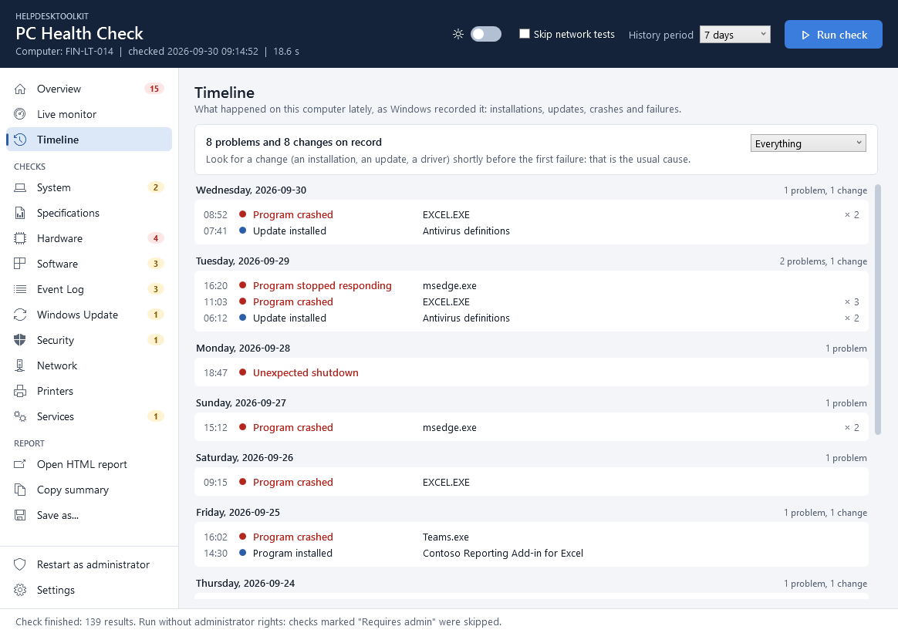

# HelpdeskToolkit

[](https://github.com/Majstor767/HelpdeskToolkit/actions/workflows/ci.yml)
[](LICENSE)


*Hrvatska verzija: [README.hr.md](README.hr.md)*

A diagnostic tool for Windows PCs, built for helpdesk and IT support work. One click or
one command checks the state of the computer and produces a clear report with the
problems it found and what to do about them.

- **Read-only.** The checks only read information and never change anything on the
  system. What the tool writes is its own: its settings, the reports and, when you
  tick "Start with Windows", one shortcut in your Startup folder. The one thing it can
  start that changes the computer is the uninstaller of a program you click in the
  disk usage list, and only after you have confirmed it.
- **No administrator rights needed.** Checks that need them are skipped and marked "Requires admin".
- **Nothing to install besides the tool.** It is written in PowerShell and uses what Windows already has.


## What it checks

| Category | Checks |
|---|---|
| System | Computer name, Windows version and build, whether that version is still supported by Microsoft, install date, manufacturer and model, domain or workgroup, signed-in user, time zone, uptime, stability index, Windows activation, startup programs, scheduled tasks that are not part of Windows, power plan, Fast Startup, last startup duration\*, size of the user profiles\*, Windows 11 readiness (on Windows 10, with every requirement), the last System File Checker result, what Windows blamed for a slow startup\* |
| Specifications | Processor with cache sizes and virtualization state, memory layout and free slots, every memory module (slot, speed, manufacturer, part number), graphics adapters with memory and driver date, displays, physical drives with firmware version, optical drives, audio devices, keyboards and pointing devices, motherboard, BIOS/UEFI, serial number, advice for an old BIOS, where the warranty is looked up |
| Hardware | CPU load, memory usage and the top memory consumers, health of every physical drive, free space per disk (the drive Windows is installed on is marked, and a full data drive gets other advice than a full Windows drive), the largest folders of a disk that is running full, space that can be freed (temporary files, Downloads, Recycle Bin), hibernation file, page file, devices without a working driver, unsigned drivers, old drivers, battery charge and battery health (capacity left compared to a new battery), drive details (temperature, wear, power-on hours, uncorrected errors)\*, drives flagged for a disk check\*, temporary files of Windows\*, result of the last memory test |
| Software | Installed programs with versions, recently installed programs, application crashes per program, browser extensions, default browser, programs that no longer get security updates, programs that are still listed although their uninstaller is gone, programs with a newer version (asked from winget), Microsoft Office with its update channel, size of the Outlook mailbox files |
| Event Log | Unexpected shutdowns, blue screens, disk errors, hardware errors (WHEA), critical events and errors in the System and Application logs for the last N days, top sources |
| Windows Update | Last installed update, updates waiting to be installed, updates that failed to install, pending restart, paused updates |
| Security | Microsoft Defender real-time protection, definition age, tamper protection, last scan and threat history, firewall profiles, User Account Control, Remote Desktop, account type, members of the Administrators group, automatic sign-in, local accounts and the Guest account, shared folders, ports open to the network and the programs behind them, backup (File History, OneDrive, System Restore), Secure Boot, TPM\*, BitLocker on every drive\*, failed sign-ins\*, account lockouts\*, restore points\*, SmartScreen, memory integrity (Core isolation), LSA protection, SMB 1.0, automatic screen lock, programs that used the camera, the microphone and the location, USB storage devices that have been connected |
| Network | Adapters (IPv4, gateway, DNS, DHCP, MAC, link speed), Wi-Fi signal, band, standard and security, network profile, proxy, hosts file, mapped network drives, ping to the gateway and to the internet, DNS resolution, HTTPS access, clock accuracy |
| Printers | Default printer, installed printers and offline ones, documents stuck in the print queue |
| Services | DHCP Client, DNS Client, Windows Event Log, Workstation, Windows Defender Firewall, Microsoft Defender Antivirus, Windows Update, BITS, Print Spooler, and the services that are not part of Windows |

\* needs administrator rights; otherwise marked "Requires admin". See [Administrator rights](#administrator-rights).

Every result has a status (**OK**, **Warning**, **Critical** or **Info**) and a short
explanation of what the checked thing is. A result with the status Warning or Critical
also says **why it is a problem**, that is what it leads to when it is left as it is,
and has a recommended fix. Measurements also show the allowed range and a typical
value for comparison.

### Compared with other health tools

The checks were compared with what other tools show: Microsoft PC Health Check, Windows
Security, the support tools of the computer makers (Dell SupportAssist, Lenovo Vantage,
HP Support Assistant), CCleaner Health Check, Microsoft PC Manager, CrystalDiskInfo,
HWiNFO, Belarc Advisor and Reliability Monitor. What helps to find the cause of a
problem was taken over, each time with the reason and the fix next to it:

| Seen in | Taken over as |
|---|---|
| PC Health Check | Windows 11 readiness with every requirement named, not only "yes" or "no"; what delayed the startup, not only how long it took |
| Windows Security | SmartScreen, memory integrity and LSA protection as checks, with a button that opens that page |
| Support tools of the makers | A button that opens the support page of the maker and copies the serial number; advice for an old BIOS; the results of the memory test and of the System File Checker |
| CCleaner, PC Manager | Programs with a newer version and programs without support, as a list; nothing is updated or removed by the tool |
| Belarc Advisor | USB storage devices that have been connected; which programs used the camera and the microphone |
| Reliability Monitor | The [Timeline](#the-window) page: changes and failures on one time line |
| HWiNFO | Recording of the Live monitor to a CSV file, now with the answer time of the network |

Left out on purpose:

- **Registry cleaners, "memory boosters" and a "fix everything" button.** They change the
  system, their benefit is doubtful, and the tool is read-only.
- **Fan speeds, voltages and the processor temperature.** They need a kernel driver of
  the tool's own, which is a security risk and needs administrator rights.
- **Updating itself, advertising and sending data anywhere.** The only things that go
  over the network are the connectivity tests and the question to winget, and both
  are switched off with "Skip network tests".

## The window


When the application starts, it asks one question: run with administrator rights or
without? After the answer the check starts by itself. The categories are checked side
by side, so it usually takes 10 to 20 seconds; a progress bar shows how many of them
are done. When the application has been used before, the results of the last check
are on the screen at once and are replaced as soon as the new check has finished.

- **Yes** starts the application again with administrator rights (Windows asks for
  confirmation first) and runs the check there, including everything that Windows
  only shows to administrators.
- **No** runs the check at once with standard rights; the checks that need more are
  marked "Requires admin".

The answer can be remembered, and changed later on the Settings page. After that first
check the application keeps the results up to date by itself; **Run check** (F5) runs
it again at any time. The options next to the button ("Skip network tests" and the
number of days of history) are remembered for the next start as well.


- **Overview** lists every problem with its recommended fix. Next to a fix there is a
  button that opens the place in Windows where it is done (**Open Storage settings**,
  **Open Task Manager**, **Open Windows Update**, ...). The button only opens that page;
  the change itself is always made by the person in front of the computer.
- **Health score** from 0 to 100 sums the check up in one number: every Critical
  result takes 15 points off, every Warning 4. The line below the tiles says where the
  points went ("Points lost: Security -19, Software -8"), so the number can be read.
- **Health score over time** draws the score of the last checks as a line, so it shows
  at a glance whether the computer is getting better or worse.
- **Since the last check** shows what is new, worse, better or resolved compared with
  the previous check of the same computer. The application keeps the last 30 reports
  for this.
- **Timeline** shows what happened on the computer in the last weeks, grouped by day:
  programs that were installed, updated or removed, updates, drivers, and next to them
  the crashes, failed updates, blue screens and unexpected shutdowns. "It worked last
  week" is where most troubleshooting starts; the change that came just before the
  first failure is usually the cause. A filter leaves only the problems or only the
  changes.
- **Side bar:** laid out like the navigation of Windows 11. The pages of the
  application come first (Overview, Live monitor, Timeline), the check categories
  under the heading *Checks*, each with an icon; the number next to a category is how
  many problems it has, red when one of them is critical. Below them are the actions
  for the report, and at the bottom the administrator rights and the settings, which
  stay in view in a low window while the rest scrolls.
- **The page of a category:** the problems come first, each across the whole width:
  what was found and why it matters on the left, the fix with its button on the
  right. Everything that needs no attention follows as tiles in three columns, with a
  dot in the color of its status; a click on a tile opens the explanation and the
  allowed range. The chips at the top count the results per status, and a click on
  one leaves only that status on the page.
- **Most severe first:** wherever results are listed below each other (Overview,
  search, the report), they come as Critical, Warning, OK, Info.
- **Search** looks through all results at once, and the status filter narrows the
  list down, for example to the problems only.
- **What this means and how to fix it:** below the recommended fix of every Warning
  and Critical result is a link to the page of Microsoft that explains the problem
  (free up drive space, troubleshoot Windows Update, blue screens, firewall, printers
  and so on); a problem without such a page gets a web search for its name.
  The page opens in your browser also where Windows itself fails to open links
  because it still names a default browser that was removed; that case is reported
  as a warning of its own under Software.
- **A link for the exact error:** where a result names an update or an error code,
  the fix has a link for each: the article of Microsoft about the update that failed
  ("About update KB5050009"), a search for the error code of Windows Update
  ("0x80070005"), for the stop code of a blue screen ("0x0000009F", listed under
  "Show more" with how often it happened) and for the code Device Manager gives a
  device that does not work ("code 28"). Only the number or the code goes into the
  address, never a name.
- **Events with their numbers:** the results of the event log list every kind of
  error under "Show more", with its source, its event number and how often it
  happened ("Event 10016: DistributedCOM (45x)"). A click on a line searches the web
  for exactly that event, which is how one finds out what it means and how it is fixed.
- **Copy summary** puts a short text version of the result on the clipboard, ready to
  paste into a ticket or an e-mail.
- **Open HTML report** saves the report and opens it in the browser; **Save as...**
  saves it as HTML, PDF, CSV or JSON wherever you choose.

### Automatic check and notices

The check is repeated in the background every five minutes (the interval can be changed
or turned off in the settings). The new results replace the old ones without
interrupting: the open page, the search and the place you have scrolled to stay as they
are. A repeated check takes only a few seconds: the one thing that is slow to measure
and changes slowly, the sizes of the largest folders, is measured again every half
hour instead of every time.

Where a check costs more than it brings, it is repeated less often: every 30 minutes
at most while the window is hidden next to the clock, every 15 on battery, and every 60
when both apply. A slower setting stays as it is, and **Run check** always checks at
once.

A problem that was not there before is announced in a bar at the top of the window, and
with a Windows notification while the window is not in front. A click leads straight to
the result, which is framed so it is easy to find. A notice disappears when it is
dismissed or when the problem is gone.




Keyboard shortcuts:

| Key | Action |
|---|---|
| `F5` | Run the check |
| `Ctrl+F` | Search; `Esc` clears the search |
| `Ctrl+O` | Open the HTML report |
| `Ctrl+S` | Save as... |
| `Ctrl+Shift+C` | Copy the summary |
| `Ctrl+M` | Live monitor |
| `Ctrl+,` | Settings |
| `Ctrl+T` | Switch between the light and the dark theme |
| `PrtSc` | Copy a picture of the window to the clipboard |

`PrtSc` is there because the application usually runs with administrator rights:
Windows then keeps the keys pressed in its window away from programs without those
rights, so the shortcut of a screenshot tool does nothing while the window is in
front. The window takes the picture itself; it shows the window only, not what else
is on the screen.

### In the background and with Windows

Two options on the **Settings** page, both off at first:

- **Keep running when the window is closed.** Closing the window then only hides it.
  The application stays as an icon next to the clock, repeats the check and announces
  a new problem with a Windows notification. A click on the icon opens the window
  again; a right click offers *Open*, *Run check now* and *Exit*, which is how the
  application is really ended. **Run in background** at the bottom of the side bar
  does the same at once, whatever this option says.
- **Start with Windows.** Puts a shortcut into the Startup folder of your user (it
  appears under *Startup apps* in Windows, where it can be turned off like any other).
  The application then starts when you sign in, without a window, as the icon next to
  the clock, and runs the check with standard rights; nothing asks for administrator
  rights while Windows is starting. Unticking the option, or uninstalling, removes the
  shortcut.

Only one copy runs at a time: starting the application while it sits next to the clock
brings its window back instead of opening a second one.

The application is built to stay open without weighing on the computer. Every check
runs in a short-lived process of its own, so its memory goes back to Windows when it
is done. The open window uses about 200 MB (about 250 MB with the Live monitor
running); hidden next to the clock it hands back what it does not need and stays at
about 15 to 35 MB of working memory. See [Memory](#memory) for how.

Should something go wrong inside the window, it stays open: the error is written to
`app.log` in the folder of the application (**Settings > About > Open the folder**),
and the status line says so.

### Language and theme

The **switch in the header** (a sun or a moon, `Ctrl+T`) turns the window from the
light to the dark theme and back, at once and without a restart. The **Settings** page,
opened with the gear button below the page list, also offers "Same as Windows" and
switches the window between English and Croatian; a new language is applied at the
next start. The reports and the commands stay in English, so a report reads the same
whoever created it. The application also remembers the size and position of its window.


The settings and the history of reports are kept in `%LOCALAPPDATA%\HelpdeskToolkit`;
the Settings page has a button that opens the folder. Deleting the folder resets the
application.

## Live monitor

The **Live monitor** page of the window needs no health check. It shows what the
computer is doing right now:

- **Status dots:** the tiles of processor, memory and graphics carry a dot. It is green
  while the value is fine, orange when it gets close to its limit or keeps rising
  towards it, and red when it is above the limit. A red dot comes with a warning
  triangle; a click on it opens advice on how to bring the value down, naming the
  program that causes the most load at that moment.
- **Everything about a component:** a click on the Processor, Memory or Graphics tile
  opens a page that fills the window with all that can be read about it. For the
  processor that is, among other things, caches, features, where its time goes and the
  load of every logical processor; for the memory every module with its part number,
  the slots and the page file; for the graphics card the driver, clock speeds, the
  programs that use it and the connected displays. The page ends with every property
  Windows reports, under the name Windows gives it. `Esc` leads back.
- **Processor:** total load with a history graph, the speed it really runs at (turbo
  included), load of every logical processor, number of processes, threads and handles,
  time since Windows started
- **Memory:** share in use with a history graph, available, cached and committed memory,
  kernel pools, page file usage
- **Graphics:** load with a history graph, load per engine (3D, copy, video decode,
  video encode), dedicated and shared memory
- **Disks:** activity with a history graph, read rate, write rate and queue length of
  every physical disk, and the used space of every drive letter (the meter turns orange
  and red by the same limits as the disk space check)
- **What takes up the space:** every drive letter can be opened to see its largest
  installed programs and folders. A click on a program asks whether to uninstall it
  and then starts the program's own uninstaller, the one Windows starts from
  *Installed apps*; a program without one (an app from the Store) opens that page
  instead, with its name copied for the search field. A button opens the page where
  files are cleaned up
- **Network:** download and upload rate with a history graph, the link speed of every
  adapter, and how quickly the router and the internet answer a ping. The **Internet**
  tile at the top shows the answer time, its average and the share of lost answers,
  with a dot of its own. A slow or silent router points to the local network (Wi-Fi,
  cable); a router that answers while the internet does not points to the provider.
  Nothing is pinged while "Skip network tests" is ticked.
- **Sensors:** temperature, fan speed and power draw of NVIDIA graphics cards; thermal
  zones and battery where the computer has them; temperature, wear and power-on hours of
  the drives\*
- **Programs:** the ones that use the most processor time, the most memory, and read and
  write the most data. Click a program to see where it was started from, who made it,
  since when it has been running and how many processes it has.

\* needs administrator rights.

Tools at the top of the page:

- **Pause** freezes the picture, and the refresh rate can be set to 2, 5, 10 or 30 seconds.
- **Record to file** writes every measurement to a CSV file in `Documents\HelpdeskToolkit`
  for 1, 5, 15 or 60 minutes. That is the answer to "it is slow sometimes": record
  while the user works, then look at the file in a spreadsheet program. The file also
  holds the answer times of the router and of the internet, which shows whether a
  call broke up because of the computer or because of the connection.
- **Alerts** appear when the processor, the memory or a disk stays above 90 % for
  several measurements in a row, or a graphics card gets hotter than 85 °C. A single
  peak is normal and raises no alert.

There is deliberately no button that ends a program, and nothing is removed by the tool
itself: it shows what takes up the space, and for a program it starts the uninstaller
the maker of the program provided, after a question. That uninstaller asks again, and
asks Windows for administrator rights where it needs them. A program that is installed
for one user only is never started from a window that runs with administrator rights;
its page in Windows is opened instead.


The same data is available in scripts through `Get-PerformanceSnapshot`.

Where the sensor values come from, and what is missing on purpose:

- The values of NVIDIA graphics cards are read with `nvidia-smi`, the status tool that
  the NVIDIA driver itself installs. It is started from the Windows `System32` folder by
  its full path. Cards of other makes have no comparable tool, so they show load and
  memory only.
- The temperature of the processor, the fans of the motherboard and voltages are not
  shown. Windows does not expose them to programs; tools that display them install a
  hardware driver of their own, which this tool deliberately does not do.

## Administrator rights

The tool works without administrator rights. Windows only shows some information to
administrators; those checks are then skipped and marked "Requires admin".

To include them, answer **Yes** when the window asks at the start, click **Restart as
administrator** later, or start PowerShell with "Run as administrator" before using
the commands. Windows asks for confirmation
(User Account Control); the tool cannot elevate itself. With administrator rights it is
still read-only.

If the confirmation is given with the account of another person (for example an IT
administrator on the computer of a standard user), the checks that describe a user
(startup programs, proxy, mapped drives, temporary files) describe that account.

## The report

The HTML report is a single self-contained file (no scripts, nothing loaded from the
internet), so it can be e-mailed or attached to a ticket. It follows the light or dark
theme of the system and has a print layout. Below the count per status it says which
category cost how many points of the score, and it ends with the timeline of changes
and failures.


A complete example with fictional data is in [docs/sample-report.html](docs/sample-report.html)
(download it and open it in a browser). The same data as JSON:
[docs/sample-report.json](docs/sample-report.json).

Other formats:

| Format | Meant for |
|---|---|
| JSON | Further processing, and comparing two checks with `Compare-PCHealthReport` |
| CSV | A spreadsheet program; one row per result |
| PDF | Archiving and printing. It is the HTML report printed to a file, which needs Microsoft Edge or Google Chrome on the computer. |

## Installation

### Installer (recommended)

1. Download `HelpdeskToolkit-Setup-<version>.exe` from the [Releases](https://github.com/Majstor767/HelpdeskToolkit/releases) page.
2. Run it. It installs for the current user only and does not ask for administrator rights.
3. Start **HelpdeskToolkit** from the Start menu.

The installer is not digitally signed, so Windows SmartScreen shows "Windows protected
your PC" the first time. Choose **More info** and then **Run anyway**. The message
only says that Windows does not know the publisher of the file yet (a certificate for
signing costs money every year); it says nothing about what the file does. You can
verify the download against `SHA256SUMS.txt` from the same release:

```powershell
Get-FileHash .\HelpdeskToolkit-Setup-<version>.exe -Algorithm SHA256
```

To remove it, use **Settings > Apps > Installed apps**.

### Portable ZIP

1. Download `HelpdeskToolkit-<version>.zip` from the [Releases](https://github.com/Majstor767/HelpdeskToolkit/releases) page.
2. Right-click the ZIP, choose **Properties**, tick **Unblock**, then extract it.
3. Double-click `Start-HelpdeskToolkit.cmd`.

### As a PowerShell module

```powershell
git clone https://github.com/Majstor767/HelpdeskToolkit.git
cd HelpdeskToolkit
Import-Module .\HelpdeskToolkit\HelpdeskToolkit.psd1
```

If PowerShell refuses to load the module because running scripts is disabled, allow
local scripts for your user account:

```powershell
Set-ExecutionPolicy -Scope CurrentUser -ExecutionPolicy RemoteSigned
```

## Usage from the command line

`Show-PCHealthCheck` opens the window described above (`-NoQuestion` opens it without
the question and without a check). Everything else works without it.

```powershell
# Run all checks, save an HTML report to Documents\HelpdeskToolkit and open it
Invoke-PCHealthCheck

# 30 days of event logs, HTML and JSON, saved to a folder of your choice
Invoke-PCHealthCheck -OutputPath C:\Temp\Reports -Days 30 -Format Both

# No browser, no connectivity tests; return only what needs attention
Invoke-PCHealthCheck -NoOpen -SkipNetwork -PassThru |
    Where-Object Status -in 'Warning', 'Critical'
```

| Parameter | Meaning |
|---|---|
| `-OutputPath` | Folder for the report. Default: `Documents\HelpdeskToolkit`. |
| `-Days` | Days of event log and crash history to analyze. Default: 7. |
| `-Format` | `Html` (default), `Json`, `Csv`, `Pdf`, `Both` (HTML and JSON) or `All`. |
| `-SkipNetwork` | Skip everything that asks the internet: the ping, DNS and HTTPS tests and the search for newer versions of the installed programs. The adapter configuration is still reported. |
| `-ComputerName` | Check another computer, see [Another computer](#another-computer). |
| `-Credential` | Account to use on the other computer. |
| `-NoOpen` | Do not open the HTML report in the browser. |
| `-PassThru` | Also return the results as objects. |

### In scripts

Each category is a command of its own, and `Get-PCHealthReport` returns everything as
one object without printing or saving anything:

```powershell
Get-HardwareHealth | Where-Object Check -like 'Disk*'
Get-NetworkHealth -SkipConnectivity
Get-ComputerSpecification | Format-Table Check, Value -AutoSize

$report = Get-PCHealthReport -Days 14
$report.Score
$report.Summary
$report.Results | Where-Object Status -eq 'Critical'

# What the computer is doing right now: load per logical processor, busiest programs
$now = Get-PerformanceSnapshot
$now.Cpu.Processors | Format-Table Name, Percent, FrequencyMHz
$now.Processes

# What went wrong in the last week, and what changed before it
Get-ChangeTimeline -Days 7 | Format-Table Time, Level, Kind, Title, Count -AutoSize
```

`Get-PCHealthReport` and `Invoke-PCHealthCheck` run the ten categories side by side,
each in a PowerShell runspace of its own, so the check takes about as long as its
slowest category instead of the sum of all. `Get-PCHealthReport -ThrottleLimit 1` runs
them one after the other, which is also how another computer is checked.

Available commands: `Invoke-PCHealthCheck`, `Show-PCHealthCheck`, `Get-PCHealthReport`,
`Compare-PCHealthReport`, `Get-SystemHealth`, `Get-ComputerSpecification`,
`Get-HardwareHealth`, `Get-SoftwareHealth`, `Get-EventLogHealth`,
`Get-WindowsUpdateHealth`, `Get-SecurityHealth`, `Get-NetworkHealth`,
`Get-PrinterHealth`, `Get-ServiceHealth`, `Get-PerformanceSnapshot`,
`Get-ChangeTimeline`. Each has full help:
`Get-Help <command> -Full`.

Every check result is an object with the same properties:

| Property | Content |
|---|---|
| `Category`, `Check` | What was checked |
| `Description` | What the checked thing is and what it does |
| `Status` | `OK`, `Warning`, `Critical` or `Info` |
| `Value` | What was found |
| `Details` | The rest of a long list (for example all startup programs) |
| `Allowed`, `Typical` | For measurements: the range reported as OK and a usual value |
| `Recommendation` | What to do when the status is not OK |

### Comparing two checks

Did the fix help? Save a JSON report before and after, and compare them:

```powershell
Compare-PCHealthReport -Reference .\before.json -Difference .\after.json |
    Format-Table Change, Category, Check, Before, After
```

Each line says whether a problem is new, worse, better or resolved. Results that did
not change are left out.

### Automation: exit codes

`Invoke-HealthCheck.ps1` in the root folder runs the check and reports the result as an
exit code, which is what monitoring systems, deployment tools and scheduled tasks
look at:

| Exit code | Meaning |
|---|---|
| 0 | No problems (every result is OK or Info) |
| 1 | At least one Warning, no Critical |
| 2 | At least one Critical |
| 3 | The check itself could not run |

```powershell
powershell.exe -NoProfile -ExecutionPolicy Bypass -File .\Invoke-HealthCheck.ps1 -Format Json -Quiet
```

### Another computer

```powershell
Invoke-PCHealthCheck -ComputerName PC-014 -Credential (Get-Credential)
```

The check then runs on the other computer through PowerShell remoting and the report
is created on yours. Nothing has to be installed on the other computer and nothing is
left behind there: the module is sent over and loaded in memory only. The requirements
are the usual ones for PowerShell remoting: it must be enabled on the other computer
(in a domain this is normally done with Group Policy) and the account must be an
administrator there.

This part is experimental. It is covered by the automated tests and was tried out by
loading the module the same way in a clean session on one computer, but not yet over a
real connection between two computers.

## Configuration

Six data files control the behaviour; no code has to be changed:

- [`HelpdeskToolkit/Config/Thresholds.psd1`](HelpdeskToolkit/Config/Thresholds.psd1):
  the limits for Warning and Critical (for example free disk space below 15 % and 5 %),
  the targets of the connectivity tests, the list of monitored services, the limits of
  the alerts and status dots in the Live monitor, the points of the health score and the end-of-support
  dates of the Windows versions (taken from the Microsoft lifecycle pages; add a line
  when a new feature release appears).
- [`HelpdeskToolkit/Config/Descriptions.psd1`](HelpdeskToolkit/Config/Descriptions.psd1):
  the explanation shown for every check.
- [`HelpdeskToolkit/Config/Risks.psd1`](HelpdeskToolkit/Config/Risks.psd1):
  why a problem matters, shown next to every Warning and Critical result.
- [`HelpdeskToolkit/Config/Actions.psd1`](HelpdeskToolkit/Config/Actions.psd1):
  which page of Windows the button next to a recommended fix opens, and the support
  pages of the computer makers.
- [`HelpdeskToolkit/Config/EndOfLife.psd1`](HelpdeskToolkit/Config/EndOfLife.psd1):
  the programs whose maker no longer releases security updates, with the date their
  support ended (taken from the lifecycle pages of the makers; add a line when another
  version runs out).

- [`HelpdeskToolkit/Config/Help.psd1`](HelpdeskToolkit/Config/Help.psd1):
  the page that explains each problem, and the address of the web search used for
  everything else. Only the name of a check, or the source and number of an event,
  ever becomes part of an address; the value of a result never does.

The "Typical" values are rules of thumb for a healthy office PC. They are shown for
comparison only and never affect the status.

A translation of the window is one more data file:
[`HelpdeskToolkit/Lang/hr.psd1`](HelpdeskToolkit/Lang/hr.psd1) holds the Croatian
texts next to their English originals. A text without a translation is simply shown in
English.

## Requirements

- Windows 10 version 1809 or later, or Windows 11, in any display language and with
  any regional settings. Dates are always written as year-month-day in the calendar
  every program reads, also where Windows counts the years differently (Saudi Arabia,
  Thailand, Iran).
- Windows PowerShell 5.1 (part of Windows) or PowerShell 7
- A screen of 1024 x 768 or more; the window makes itself fit a smaller laptop screen.
- PowerShell must be allowed to run in full: on a computer whose organization
  restricts it (AppLocker or App Control for Business, "Constrained Language Mode")
  the tool does not start.

## Development

```text
HelpdeskToolkit/          the module
  Public/                 exported commands, one per file
  Private/                internal helpers, one per file
  Config/                 thresholds, descriptions, consequences and the targets of the fix buttons
  Lang/                   translations of the window
  Assets/                 report stylesheet, window layout (XAML), dark theme, icon
tests/                    Pester tests
tools/                    scripts for testing, building and generating assets
installer/                Inno Setup script
docs/                     sample report, screenshots, notes on publishing
.github/workflows/        CI and release automation
Invoke-HealthCheck.ps1    the check with an exit code, for automation
Start-HelpdeskToolkit.*   starts the window
```

The changes of every version are listed in [CHANGELOG.md](CHANGELOG.md).

### Tests

The tests use [Pester](https://pester.dev) 5 or later with mocks, so the result does not
depend on the computer they run on. Code style is checked with
[PSScriptAnalyzer](https://github.com/PowerShell/PSScriptAnalyzer).

```powershell
Install-Module Pester -MinimumVersion 5.5.0 -Scope CurrentUser -Force -SkipPublisherCheck
Install-Module PSScriptAnalyzer -Scope CurrentUser -Force

.\tools\Test-Project.ps1            # PSScriptAnalyzer and all tests
.\tools\Test-Project.ps1 -Coverage  # also report the code coverage
```

Windows PowerShell 5.1 and PowerShell 7 keep their modules in different folders, so
install the two modules in each version you want to test with.

GitHub Actions runs the same script on Windows PowerShell 5.1 and PowerShell 7 for every push.

### Speed

What keeps the application quick, and where to look when it is not:

- The module has about 230 files with one function each. They are read into one text
  and loaded as one block, which takes a third of the time of loading them one by
  one. With the environment variable `HELPDESKTOOLKIT_LOAD_FILES` set to `1` they are
  loaded file by file again, so an error names its file and line; the tests do that.
- The check categories run side by side (`Invoke-ParallelCommand`). The load of the
  processor is measured before they start, so the check does not measure itself.
- Folder sizes are measured by several threads that hand work over to each other
  (`Get-FolderSizeBatch`), within a time budget. A size that could not be measured to
  its end within the budget is shown with "or more" ("12.4 GB or more"). The loop of
  a thread calls one .NET method per folder and no more: in PowerShell 7 a method
  call from a script is slow and the threads have to take turns for it, which made
  eight threads no faster than one until the loop was written that way.
- The Live monitor asks for the performance classes of Windows all at once
  (`Get-CimInstanceBatch`): one measurement takes about half a second instead of two.

### Memory

What keeps the window small, measured on the development computer with Windows
PowerShell 5.1:

| | Before | Now |
|---|---|---|
| Window open, first check done | about 470 MB | about 215 MB |
| After several repeated checks, Live monitor open | 500 to 650 MB | about 250 MB |
| Hidden next to the clock | as above | 15 to 35 MB working set |

- A check loads a dozen Windows modules, and PowerShell never returns that memory
  while the process lives. Every check therefore runs in a process of its own
  (`HelpdeskToolkit\Invoke-CheckWorker.ps1`), which ends with the check. A runspace of
  the window starts it, turns the lines it writes into progress records and reads the
  report it leaves as JSON (`Invoke-WindowCheck`, `Receive-WindowCheck`).
- The folder sizes a repeated check may reuse are kept in a file in the folder of the
  application, because the process that measured them is gone (`Get-ProcessCache`).
- After a check, and when the window is hidden, the memory .NET no longer uses is
  collected and handed back to Windows (`Optimize-ProcessMemory`).
- A hidden window gives up the runspace of the Live monitor and the connections it
  measures with. The loop is told to end, and the runspace is released once it has
  (`Clear-WindowWorker`).

`Write-AppLog` writes what went wrong to `app.log` in the folder of the application.
Every timer of the window catches its own errors: a timer whose handler fails is
never called again by Windows, which would leave a window that looks alive and no
longer updates.

### Building a release

```powershell
.\tools\Build-Release.ps1           # installer (needs Inno Setup 6), ZIP and checksums in dist\
.\tools\Build-Release.ps1 -SkipInstaller
.\tools\New-TestPackage.ps1         # a folder to hand to a tester: installer, unpacked portable copy, instructions
```

Pushing a tag such as `v1.0.0` runs the tests, builds the installer and the ZIP and
publishes them as a GitHub release. The tag must match `ModuleVersion` in the manifest.
The steps for a release, the PowerShell Gallery and winget are written down in
[docs/publishing.md](docs/publishing.md).

### Generated files

```powershell
.\tools\New-SampleReport.ps1        # docs\sample-report.html and .json (fictional data)
.\tools\New-Screenshot.ps1          # docs\screenshot-*.png and docs\demo.gif
.\tools\New-AppIcon.ps1             # the application icon
.\tools\Test-HelpLink.ps1           # asks every page in Config\Help.psd1 whether it still exists
```

## Privacy and legal notes

- **No telemetry.** The program has no server and no account, and sends nothing about
  you or your computer to anyone. Which network connections it makes (the connectivity
  tests, winget, and the pages you open by clicking a link) and how each is avoided is
  listed in [PRIVACY.md](PRIVACY.md).
- **A report contains personal data**: the name of the computer, user names, installed
  programs, network addresses, the serial number. Share it with care, and never in a
  public issue.
- **Use it only on computers you own or are allowed to examine.** That holds above all
  for `-ComputerName` and for reports of computers other people use.
- **No warranty.** The tool is free software under the MIT License and is provided
  "as is". Its results and suggestions are general information, not professional
  advice; they can be wrong or out of date. Keep a backup before you change a computer.
- **Not a Microsoft product.** HelpdeskToolkit is an independent project and is not
  affiliated with or endorsed by Microsoft. Windows and the other product names are
  trademarks of their owners.

The details are in [NOTICE.md](NOTICE.md); how to report a security problem is in
[SECURITY.md](SECURITY.md), and what to mind when contributing in
[CONTRIBUTING.md](CONTRIBUTING.md).

## License

[MIT](LICENSE). Copyright (c) 2026 Antonio Majstorovic.
