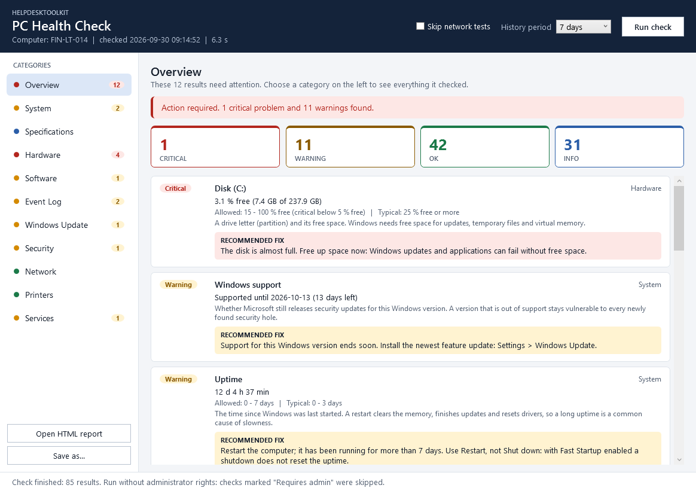
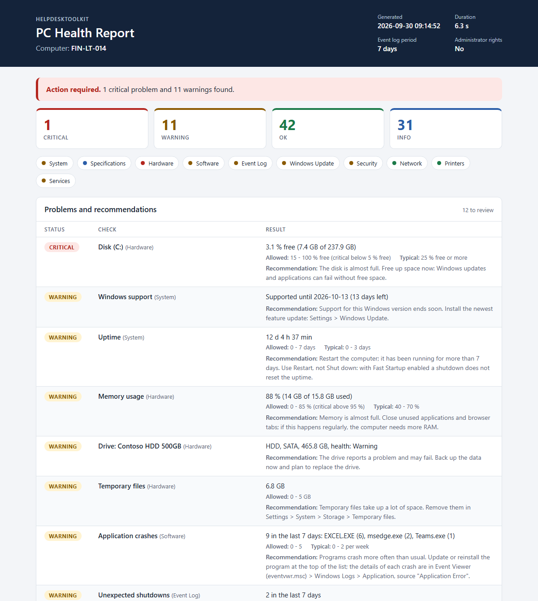

# HelpdeskToolkit

[](https://github.com/Majstor767/HelpdeskToolkit/actions/workflows/ci.yml)
[](LICENSE)


*Hrvatska verzija: [README.hr.md](README.hr.md)*

A diagnostic tool for Windows PCs, built for helpdesk and IT support work. One click or
one command checks the state of the computer and produces a clear report with the
problems it found and what to do about them.

- **Read-only.** It only reads information and never changes anything on the system.
- **No administrator rights needed.** Checks that need them are skipped and marked "Requires admin".
- **Nothing to install besides the tool.** It is written in PowerShell and uses what Windows already has.



## What it checks

| Category | Checks |
|---|---|
| System | Computer name, Windows version and build, whether that version is still supported by Microsoft, install date, manufacturer and model, domain or workgroup, signed-in user, time zone, uptime, stability index, Windows activation, startup programs |
| Specifications | Processor, memory modules and free slots, graphics adapters, motherboard, BIOS/UEFI, serial number |
| Hardware | CPU load, memory usage and the top memory consumers, health of every physical drive, free space per disk, space that can be freed (temporary files, Downloads, Recycle Bin), page file, devices without a working driver, battery |
| Software | Installed programs with versions, recently installed programs, application crashes per program, default browser |
| Event Log | Unexpected shutdowns, blue screens, critical events and errors in the System and Application logs for the last N days, top sources |
| Windows Update | Last installed update, pending restart, paused updates |
| Security | Microsoft Defender real-time protection, definition age, tamper protection and last scan, firewall profiles, User Account Control, Remote Desktop, account type, local accounts and the Guest account, shared folders, Secure Boot, TPM\*, BitLocker\* |
| Network | Adapters (IPv4, gateway, DNS, DHCP, MAC, link speed), network profile, proxy, hosts file, mapped network drives, ping to the gateway and to the internet, DNS resolution, HTTPS access, clock accuracy |
| Printers | Default printer, installed printers and offline ones, documents stuck in the print queue |
| Services | DHCP Client, DNS Client, Windows Event Log, Workstation, Windows Defender Firewall, Microsoft Defender Antivirus, Windows Update, BITS, Print Spooler |

\* needs administrator rights; otherwise marked "Requires admin".

Every result has a status (**OK**, **Warning**, **Critical** or **Info**), a short
explanation of what the checked thing is, and a recommended fix whenever the status is
Warning or Critical. Measurements also show the allowed range and a typical value for
comparison.

## The report

The HTML report is a single self-contained file (no scripts, nothing loaded from the
internet), so it can be e-mailed or attached to a ticket. It follows the light or dark
theme of the system and has a print layout.



A complete example with fictional data is in [docs/sample-report.html](docs/sample-report.html)
(download it and open it in a browser). The same data as JSON:
[docs/sample-report.json](docs/sample-report.json).

## Installation

### Installer (recommended)

1. Download `HelpdeskToolkit-Setup-<version>.exe` from the [Releases](https://github.com/Majstor767/HelpdeskToolkit/releases) page.
2. Run it. It installs for the current user only and does not ask for administrator rights.
3. Start **HelpdeskToolkit** from the Start menu.

The installer is not digitally signed, so Windows SmartScreen shows "Windows protected
your PC" the first time. Choose **More info** and then **Run anyway**. You can verify
the download against `SHA256SUMS.txt` from the same release:

```powershell
Get-FileHash .\HelpdeskToolkit-Setup-<version>.exe -Algorithm SHA256
```

To remove it, use **Settings > Apps > Installed apps**.

### Portable ZIP

1. Download `HelpdeskToolkit-<version>.zip` from the [Releases](https://github.com/Majstor767/HelpdeskToolkit/releases) page.
2. Right-click the ZIP, choose **Properties**, tick **Unblock**, then extract it.
3. Double-click `Start-HelpdeskToolkit.cmd`.

### As a PowerShell module

```powershell
git clone https://github.com/Majstor767/HelpdeskToolkit.git
cd HelpdeskToolkit
Import-Module .\HelpdeskToolkit\HelpdeskToolkit.psd1
```

If PowerShell refuses to load the module because running scripts is disabled, allow
local scripts for your user account:

```powershell
Set-ExecutionPolicy -Scope CurrentUser -ExecutionPolicy RemoteSigned
```

## Usage

### The window

```powershell
Show-PCHealthCheck
```

Click **Run check**. The **Overview** page lists every problem with its recommended fix.
Choose a category on the left (System, Hardware, Network, ...) to see everything it
checked; the dot and the number next to each category show where the problems are.
**Open HTML report** saves the report and opens it in the browser; **Save as...** saves
it as HTML or JSON wherever you choose.

### The command line

```powershell
# Run all checks, save an HTML report to Documents\HelpdeskToolkit and open it
Invoke-PCHealthCheck

# 30 days of event logs, HTML and JSON, saved to a folder of your choice
Invoke-PCHealthCheck -OutputPath C:\Temp\Reports -Days 30 -Format Both

# No browser, no connectivity tests; return only what needs attention
Invoke-PCHealthCheck -NoOpen -SkipNetwork -PassThru |
    Where-Object Status -in 'Warning', 'Critical'
```

| Parameter | Meaning |
|---|---|
| `-OutputPath` | Folder for the report. Default: `Documents\HelpdeskToolkit`. |
| `-Days` | Days of event log and crash history to analyze. Default: 7. |
| `-Format` | `Html` (default), `Json` or `Both`. |
| `-SkipNetwork` | Skip ping, DNS and HTTPS tests. The adapter configuration is still reported. |
| `-NoOpen` | Do not open the HTML report in the browser. |
| `-PassThru` | Also return the results as objects. |

### In scripts

Each category is a command of its own, and `Get-PCHealthReport` returns everything as
one object without printing or saving anything:

```powershell
Get-HardwareHealth | Where-Object Check -like 'Disk*'
Get-NetworkHealth -SkipConnectivity
Get-ComputerSpecification | Format-Table Check, Value -AutoSize

$report = Get-PCHealthReport -Days 14
$report.Summary
$report.Results | Where-Object Status -eq 'Critical'
```

Available commands: `Invoke-PCHealthCheck`, `Show-PCHealthCheck`, `Get-PCHealthReport`,
`Get-SystemHealth`, `Get-ComputerSpecification`, `Get-HardwareHealth`,
`Get-SoftwareHealth`, `Get-EventLogHealth`, `Get-WindowsUpdateHealth`,
`Get-SecurityHealth`, `Get-NetworkHealth`, `Get-PrinterHealth`, `Get-ServiceHealth`. Each has full help: `Get-Help <command> -Full`.

Every result is an object with the same properties:

| Property | Content |
|---|---|
| `Category`, `Check` | What was checked |
| `Description` | What the checked thing is and what it does |
| `Status` | `OK`, `Warning`, `Critical` or `Info` |
| `Value` | What was found |
| `Details` | The rest of a long list (for example all startup programs) |
| `Allowed`, `Typical` | For measurements: the range reported as OK and a usual value |
| `Recommendation` | What to do when the status is not OK |

## Configuration

Two data files control the behaviour; no code has to be changed:

- [`HelpdeskToolkit/Config/Thresholds.psd1`](HelpdeskToolkit/Config/Thresholds.psd1):
  the limits for Warning and Critical (for example free disk space below 15 % and 5 %),
  the targets of the connectivity tests, the list of monitored services and the
  end-of-support dates of the Windows versions (taken from the Microsoft lifecycle
  pages; add a line when a new feature release appears).
- [`HelpdeskToolkit/Config/Descriptions.psd1`](HelpdeskToolkit/Config/Descriptions.psd1):
  the explanation shown for every check.

The "Typical" values are rules of thumb for a healthy office PC. They are shown for
comparison only and never affect the status.

## Requirements

- Windows 10 version 1809 or later, or Windows 11
- Windows PowerShell 5.1 (part of Windows) or PowerShell 7

## Development

```text
HelpdeskToolkit/          the module
  Public/                 exported commands, one per file
  Private/                internal helpers, one per file
  Config/                 thresholds and descriptions
  Assets/                 report stylesheet, window layout (XAML), icon
tests/                    Pester tests
tools/                    scripts for testing, building and generating assets
installer/                Inno Setup script
docs/                     sample report and screenshots
.github/workflows/        CI and release automation
```

### Tests

The tests use [Pester](https://pester.dev) 5 or later with mocks, so the result does not
depend on the computer they run on. Code style is checked with
[PSScriptAnalyzer](https://github.com/PowerShell/PSScriptAnalyzer).

```powershell
Install-Module Pester -MinimumVersion 5.5.0 -Scope CurrentUser -Force -SkipPublisherCheck
Install-Module PSScriptAnalyzer -Scope CurrentUser -Force

.\tools\Test-Project.ps1            # PSScriptAnalyzer and all tests
.\tools\Test-Project.ps1 -Coverage  # also report the code coverage
```

GitHub Actions runs the same script on Windows PowerShell 5.1 and PowerShell 7 for every push.

### Building a release

```powershell
.\tools\Build-Release.ps1           # installer (needs Inno Setup 6), ZIP and checksums in dist\
.\tools\Build-Release.ps1 -SkipInstaller
```

Pushing a tag such as `v1.0.0` runs the tests, builds the installer and the ZIP and
publishes them as a GitHub release. The tag must match `ModuleVersion` in the manifest.

### Generated files

```powershell
.\tools\New-SampleReport.ps1        # docs\sample-report.html and .json (fictional data)
.\tools\New-Screenshot.ps1          # docs\screenshot-*.png
.\tools\New-AppIcon.ps1             # the application icon
```

## License

[MIT](LICENSE)
